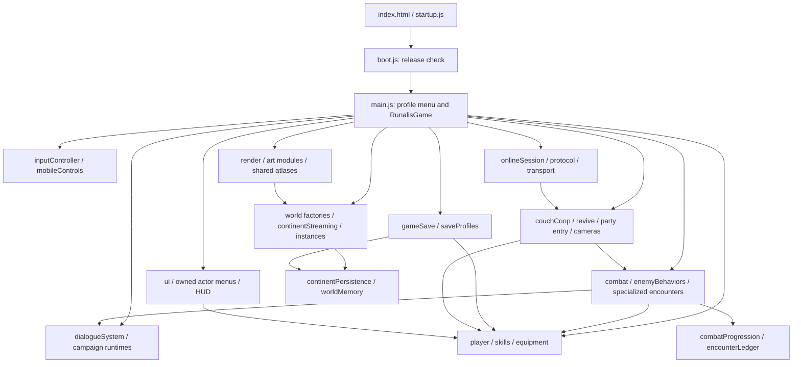

# RUNALIS engineering health audit

Initial assessment · October 31, 2026 · baseline `8fca54d` plus the existing working tree.

RUNALIS has a functioning, extensively developed Canvas 2D architecture and useful
regression coverage. A replacement engine, wholesale rewrite or mass reorganization
is not justified. Save failure recovery and multiplayer authority/identity deserve
attention before broad cleanup. One bounded set of save-loss defects was repaired
during this assessment; the remaining work is prioritized in the
[Engineering Quality Register](ENGINEERING_QUALITY_REGISTER.md).

The [Engineering Standards](RUNALIS_ENGINEERING_STANDARDS.md) govern future changes.
[Generated structural evidence](engineering-audit/INVENTORY.md) and
[validation results/reproduction details](engineering-audit/VALIDATION.md) support this report.

## Scope and evidence

Inspected the repository layout, production import graph, principal owners and
cross-system interfaces, save/migration writers, local/online co-op paths, update
orchestration, lifecycle/cache patterns and build/validation tools. Parsed all
JavaScript under `src/`, `tools/` and the nested archive. This is a comprehensive
architectural assessment, not an assertion that every branch of every module or
every asset was manually reviewed or played.

The briefing's Babylon.js description does not match the repository. There is no
Babylon dependency, scene graph, mesh/material disposal pipeline or framework
runtime. Real equivalents here are Canvas surfaces, atlas images, Web Audio nodes,
plain world/entity records, DOM/menu documents and WebRTC connections.

At the initial inventory there were 342 JavaScript files in `src/`, 16 root HTML
pages and 276 `verify-*` scripts. New audit/gate tools increase the final script
count; regenerate the inventory rather than relying on historical counts.
The startup graph has 326 module identities across 325 physical files. It includes
the literal dynamic PeerJS import but not classic `startup.js` or menu-frame code
constructed at runtime. Six cyclic components contain 33, 13, 10, 3, 3 and 3 files.
These are coupling evidence, not six demonstrated initialization failures.

## Repository and entry points

| Location | Actual role |
| --- | --- |
| Root `index.html`, CSS, `src/` | Playable application and native module development files. |
| `src/startup.js` → `boot.js` → `main.js` | Classic recovery loader, release check, dynamic game import, profile menu/game construction. |
| Root `*-lab.html` pages | Separate art, combat, equipment, world and creator review entry points; excluded from Pages staging. |
| `src/vendor/` | Vendored PeerJS 1.5.5 and license; dynamically loaded for online play. |
| `assets/` | Runtime images, fonts, icons and authoring material; the build allowlists runtime directories. |
| `tools/` | Node model assertions, Playwright browser checks, benchmarks, Python authoring/asset tools and historical patch scripts. They are not all release gates. |
| `docs/` | Current director bibles/audits and historical feature reports/captures. Historical counts/contracts can be stale. |
| `Runalis/` | Tracked older upload with its own HTML/source, absent from the production graph and Pages output. It is not a competing active simulation. |
| `_site/` | Ignored, regenerated deployment artifact. Never edit it as source. |
| `backups/`, `tmp/`, `.agents/` | Ignored local history, diagnostics and authoring state; not production. |

No existing `AGENTS.md` applied to this workspace at the start. A short root file
now directs future agents to the engineering references and baseline checks.
Existing uncommitted Art/Narrative/Combat/Multiplayer work and the modified
Malakar browser fixture were preserved. No branch switch, commit, push or deployment occurred.

## Runtime and dependencies

This is an ownership/dependency overview, not a claim of a strictly layered graph.
For example, `world`/travel/story/player dependencies are cyclic, and some combat
modules import presentation. The inventory lists actual strongly connected components.

### Initialization, loop and scenes

`boot()` binds the profile menu and page-lifetime release checks. `startProfile()`
guards duplicate starts, destroys the previous game, shows loading, and constructs
`RunalisGame` after two animation frames. Startup import errors expose a retry UI.
The constructor creates a caravan/developer world, player, audio/input/UI, mobile
and online components, restores the destination if loading, attaches local players
and starts the frame loop. A failed constructor after binding is a cleanup risk;
the caller cannot destroy an object it never received.

`RunalisGame.loop()` computes seconds with a 0.033-second cap, polls controllers,
routes menus/readiness/death/pause input, runs local/host simulation or guest
replication, then updates camera/audio and draws. Ordinary HUD refresh is throttled
to 0.2 seconds. Split-screen performs multiple draws of the same simulation.
Destroyed games set `started=false`, so the pending animation callback stops.

`update()` sequences world streaming, migrations, dialogue/campaign/discovery,
host combat/movement, co-op actor updates, enemy AI/encounters/respawns, summons,
loot, instance progression and effects. `updateCoopWorldWhileHostBusy()` repeats
much of the world tail so a teammate can continue during an owned menu. Revive
timers are invoked at several checkpoints; their expiry uses `now`, so repeated
calls alone do not prove accelerated bleedout. Extract only after branch-parity tests.

There is no Babylon scene manager. `game.world` changes between factories for
caravan, capital/interiors, continent, travel, dungeon, tower, side zone and PvP.
`gameInteraction`, travel and instance modules coordinate transitions;
`gameSave.applySaveToGame` reconstructs destinations. `overworldState`, instance
memory and continent persistence retain return/progression state.

### Entities, player, progression and inventory

Entities are plain records with stable content/entity IDs and kind/mode fields,
stored in world arrays and continental chunk maps. `world.js` centralizes collision,
movement and visibility integration; `overworldUtils` supplies entity factories.
Continental resident arrays are local subsets, not the whole logical continent.
`continentRuntime.allObjects/allEnemies`, generated entity records and world memory
must be considered before declaring something absent or resetting it.

`player.js` creates/migrates actor state and computes vitals. `skills.js` and
`progressionMath/Profiles` own actual progression; legacy display mirrors are
intentional compatibility. Inventory helpers and `equipmentProgressionSystem`,
`setBonusSystem`, equipment-bound skills, crafting, shops and workshops own their
transactions and modifiers. UI reads the live actor through its owned game view.

Class identity is still duplicated between `classData.js` and `player.js`, despite
the former's single-source comment. A comparison finds differing `eAbility`,
ability slot and metadata fields. Alias normalization also appears in several
combat/presentation modules. This is a real consolidation opportunity; replacing
every table/helper blindly would change behavior.

### Combat, abilities and AI

`data.js` composes the main item/ability registry with dedicated expansion data.
`abilityLoadoutSystem` owns assignment/unlocks; morph, mastery, expertise, use-charge,
hold-charge and channel modules have distinct responsibilities. Similar names do
not establish duplicated mechanics. `combatPower`, `progressionMath` and
`combatProgression` already centralize major calculations and reward attribution.

`combat.js` orchestrates player attacks/abilities, ordinary enemies, summons and
death/rewards, using `combatMoves`, `combatActions`, `enemyBehaviors`, elite tactics
and specialized boss modules. The current `enemyAI.js` is an unlinked older
floating-text implementation, not the live enemy AI. Advanced damage and ordinary
damage paths overlap; compare mitigation/proc order before consolidating.

Re-executed Combat foundation probes confirm C01 overkill lifesteal, C02 reflection
without XP attribution, C03 unreachable Blackbow set thresholds and C04 P2 support
not reaching the host. Follow the Combat audit for detailed mechanics; engineering
changes must preserve formulas and intentional class differences.

### Quests, dialogue and UI

`worldContent` integrates authored quest/dialogue/location definitions.
`dialogueSystem` performs live transitions, objective forwarding and compatibility
bridges; `dialogueRuntime` owns presentation/input phases. Campaign, opening,
story, discovery and POI runtimes add specific orchestration.
`player.quests` is the live log; `questState` and simple `quest` flags are bridged.
The alternate `questSystem` writes a different state surface and is still imported
by a UI verification fixture. Retire that consumer before considering removal.

`ui.js`, panel modules, `menuSheets`, controller navigation, HUD/minimap and mobile
modules render and route the interface. Local co-op menus use separate iframe
documents/focus state referencing the actual actor, not independent simulations.
This solves ownership/focus problems but loads a source UI graph even in a bundled
release, so packaged tests must exercise it directly.

### Local co-op and networking

`couchCoop` joins up to three additional actors with distinct profile IDs, inventory,
equipment, skills and controller ownership; runtime `questOwner` links shared-world
context to the host. `inputController` tracks logical devices across browser index
changes. Camera/shared-screen modules and `splitScreenHud` handle adaptive/forced
split views. `partyEntrySystem` handles consent; revive and enemy scaling remain
separate modules. Automated controller tests use simulated devices.

Online play is already implemented. `onlineTransport` loads PeerJS/WebRTC and
chunks messages; `onlineProtocol` handles serialization, password-derived room
proofs and bounded inputs. `onlineSession` runs one host simulation, uses the
co-op actor path for remotes, sends state near 10 Hz and guest controls near 25 Hz,
interpolates presentation and restores guest home-world state when leaving.
It is a small peer-hosted co-op model, not a trusted authoritative server.

Confirmed issues: loot uses reusable session slots as recipient identity;
authenticated menu updates accept arbitrary guest-owned gold/character fields;
the sender permits a packet requiring more frames than the receiver accepts.
The trust correction needs the Multiplayer director's imported-character/service
contract, not an enterprise account/networking replacement.

### Saves and failure boundaries

`saveProfiles` normalizes schema 18 and compatibility fields; `gameSave` reads/writes
the main localStorage collection, snapshots slim state and reconstructs worlds.
`couchCoop` independently implements a second reader/writer/migrator for that same
collection. Online guests save locally through `upsertProfile`, retaining their
original world/story fields through `guestSaveState`.

Transient combat/revive/visual state is filtered; cooldowns are rebased. Sparse
continent memory retains deaths, harvests, generated encounters and exploration;
instance memory retains repeatable returns. Existing normalization wrappers and
legacy aliases are compatibility obligations, not automatically removable code.

Fixed in this pass: legacy cleanup before successful writes, loss of malformed
legacy co-op recovery data and emergency fallback truncation to six profiles.
No schema/field/ID changed. Still open: an unreadable active collection is treated
as `{}` by both readers; a subsequent write can destroy its recovery bytes.
This needs coordinated reader/writer/UI error propagation rather than another
silent fallback. Browser storage remains per origin/device; no cloud save is present.

### Rendering, assets, resource lifetime and performance

`render` coordinates terrain, depth-ordered actors/objects, combat effects and
foreground presentation. Art/animation modules implement pixel sprites and code
drawing; `spriteArt` owns atlas records and a bounded variant cache. Terrain uses
world-keyed weak caches with bounded chunks. Continental collision/decor caches
are bounded, and transient chunk residents have retirement paths.

`destroy()` removes game-owned global listeners and destroys local menu/mobile/
online/death/editor resources. Mobile controls use `AbortController`; online
disconnect clears peers, connections, maps and restores its clock override.
Audio/shell/fullscreen listeners are guarded page-lifetime resources and should
not be removed whenever a player changes worlds.

Twenty packaged load/move/save/quit cycles (ten per deployment path) stopped old
draw loops and held the measured listener count at 364. Post-GC JS heap rose from
about 10.3 to 12.7 MiB per context with slowing growth. This does not establish
either an unbounded leak or leak freedom; heap retaining-path work is warranted
before changing caches. Neither GPU/native bitmap memory nor a long-session soak
was measured. Idle town animation-frame intervals are recorded, not a combat FPS claim.

Potentially costly paths include per-frame migration/derived-state refresh,
resident entity iteration, repeated scene draws and per-recipient network scans/
JSON diffs. Existing performance reports contain historical CPU/heap baselines.
No new bottleneck was demonstrated here, so no speculative pooling, worker,
entity framework or caching rewrite was introduced.

## Duplication, obsolete code and dependencies

| Candidate | Evidence and safe next step |
| --- | --- |
| Two unified profile storage implementations | Same storage key and migration concern in `gameSave`/`couchCoop`; both needed the same durability repair. Extract a small DOM-free boundary after host/co-op/recovery contract tests. |
| Class tables/alias helpers | Live definitions differ; inventory consumers and preserve intentional fields before consolidating onto `classData`. |
| Ordinary/advanced defensive damage | Separate mitigation/proc ordering; establish parity with Combat before a common mechanism. |
| Main update tails | Normal and host-menu paths repeat world work; branch/owner tests must precede extraction. |
| `enemyAI.js` | No production importer, contains old floating-text helpers duplicating the live module's responsibility; referenced by historical/protected-file tooling. Removal candidate after that tooling is updated. |
| `questSystem.js`, `dungeon.js` | Outside startup; UI verification imports the former and roster tooling loads the latter. Do not delete on reachability alone. |
| `storyData`, `companionData`, `bossData`, `dungeonData`, `storyContentIndex` | Dormant authored data / tool inputs, not proven worthless. Coordinate with Narrative/Combat before retiring content. |
| `startup.js`, lab modules/roster, `dialogueValidation` | Separate HTML/tool entry points; correctly absent from the startup graph. |
| Nested `Runalis/`, historical patch tools | Not shipped. Clarify archival role before future cleanup; no initial deletion is necessary. |

Only build-time esbuild is installed through `package.json`; `prepare-pages` imports
it directly. No unused npm dependency or duplicate library framework was found.
`npm audit --json` reports zero known vulnerabilities for the lockfile at audit time.
It does not assess the vendored PeerJS distribution, game logic or future advisories.
No dependency was added/upgraded and no significant code or asset was removed.

## Validation and incremental sequence

Build: 865 staged files, 38.9 MiB, with a 3.2 MiB startup bundle. Filename case,
literal resource references and startup imports validate. Of 30 selected existing
model suites, 28 pass; the other two reproduce with the pre-change save modules.
The new storage regression has 12 passing scenarios. Packaged smoke and co-op
session browser checks pass. The legacy Pages sprite-status fixture still fails.
See the validation record for exact boundaries and commands.

`npm run check:engineering` now provides 11 small portable checks, including syntax/
startup linkage, save durability, co-op state, progression, protocol, quest migration
and ability assignment. Pages runs it before staging; a minimal PR workflow also
runs the gate/build. Known wider failures are explicitly recorded, not relabeled green.
No new linter/test framework or dependency was added.

1. **Correctness:** protect unreadable active storage; define and enforce online
   character-update authority; fix stable loot identity and support/reward ownership.
2. **Consolidation:** unify profile storage under tested durability/error contracts,
   reconcile class definitions, then compare defensive damage paths.
3. **Targeted refactoring:** repair stale fixtures/room metadata; reduce the next
   changed dependency cycle or repeated update tail with branch-parity coverage.
4. **Performance/lifecycle:** profile dense combat and 1/2/4-player sessions, cold
   continent transitions and retained heaps; correct only demonstrated causes.
5. **Safeguards:** convert each fixed defect probe to an ordinary regression, expand
   packaged co-op/mobile acceptance and representative save fixtures, then expand CI.
6. **Governance:** apply the root guidance/standards to future feature reviews and
   keep this register current. Review the affected system, not the whole game each time.

Suitable first assignments are active-save recovery (E02), host character-update
authority (E03), or party/support/reward ownership (E04–E06). Each has a concrete
reproduction and bounded acceptance criteria; none requires replacing the engine.
