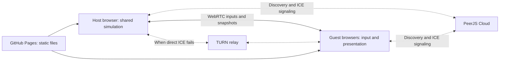

# RUNALIS Multiplayer Technical Bible

Established October 31, 2026. Scope: the active root `src/` runtime, not the
historical nested `Runalis/` upload. Assessment baseline: commit
`8fca54d67037679666713bb5470f56718d52aece` plus the existing working tree.
This assessment adds documentation and diagnostics; it changes no gameplay,
progression, persistence policy, transport, service configuration or dependency manifest.

Companion records:

- [Prioritized defects, risks and implementation order](RUNALIS_MULTIPLAYER_AUDIT.md).
- [Executed validation and reproduction instructions](multiplayer-audit/README.md).
- [Combat ownership and protected mechanics](RUNALIS_COMBAT_BIBLE.md).
- [Visual identity and asset contracts](RUNALIS_ART_BIBLE.md).

## 1. Evidence and decision status

**Established requirement** means the director's brief or an existing protected
design rule. **Observed** means current source behavior. **Verified** means an
explicit check executed during this assessment. **Proposed** means a future
implementation, not a completed feature or a new approved gameplay rule.
**Unresolved** means evidence or direction is still required. A known defect
described here is not an approved design decision.

Earlier reports remain historical evidence. In particular, the older co-op
readiness note saying local menus are single-owner and reconnect requires the
same hardware index is superseded by `localPlayerMenus.js`, the logical device
manager, and the newer local-menu/session regression reports.

## 2. Multiplayer philosophy and supported experiences

Established: preserve independent agency, character ownership and single-player
behavior. Share gameplay rules and one authoritative world simulation. Do not
rebalance combat, change progression sharing, add infrastructure costs, or change
the supported player count as a networking workaround.

| Experience | Observed implementation | Authority and limits |
| --- | --- | --- |
| Single player | One actor, keyboard/mouse, primary controller or touch | Local simulation; no PeerJS connection until hosting/joining |
| Local couch co-op | P1 plus up to three profile-backed actors | One machine, one world update; shared/adaptive or split presentation |
| Online co-op | One host plus up to three remote guests | Host simulates shared gameplay; guests render full-screen snapshots and send controls |

Local and online parties are mutually exclusive in the current session code.
Hybrid couch-plus-online play is not supported. A loaded character opens or joins
a password-selected world; the current UI does not use short room codes or a
separate pre-game character-selection lobby. Keep the four-player limit and
existing flow while repairing reliability. Any redesign of that experience
requires direction.

The actual game is **Canvas 2D with native JavaScript modules**, not Babylon.js.
`main.js` owns the loop, `world.js` owns shared world helpers, and `render.js`
orchestrates drawing. Babylon cameras, scene replication and a new engine are
unnecessary for this architecture.

## 3. Player identities, input and state boundaries

| State | Current location and meaning | Required boundary |
| --- | --- | --- |
| Persistent character | `profileId`, character data, browser-local profile collection | Never use a display slot as lasting ownership |
| Party placement | `slot`, `playerNumber`, `sessionSlot` (1–4) | Session presentation only; slots can be reused |
| Local control | Logical `controllerSlotIndex` (0–3), controller manager device reservations | Hardware index is not player identity |
| Remote connection | `networkRemote`, `networkId`; host uses synthetic input slots `100 + party slot` | Bind commands to the authenticated connection's actor |
| Online map color | Transient `partyMapSlot` supplied by host | Guest local gameplay slot remains 1; save strips map identity |
| Character simulation | Actor inventory, equipment, resources, cooldowns, skills, mastery, summons, statuses and combat state | Operate on the actor passed to the common gameplay system |
| Shared world | `game.world`, enemies, resources, objects, drops, instance state | One authority, one outcome per event |
| Session | `currentSession`, controller assignments, online clients, entry consent | Transient; never restore active peers/votes from a profile |
| Presentation | Cameras, viewport layout, menu documents, interpolation, replicated visuals | Must not create gameplay rewards or damage |

Observed: P1 is `game.player`; allies are in `player.coop.players`. Each ally is
migrated independently. `getActorGameView(actor)` adapts existing service/UI code
to that actor using a cached view of the host game. It is a useful compatibility
layer, not a separate simulation. Inherited mutable fields still require review
when adding actor-specific services.

`attachRuntimeOwner` adds a non-enumerable `questOwner` reference to the world
owner. It deliberately does not mean that equipment or combat progression is
shared. Save and wire sanitizers exclude runtime references and presentation data.
Confirmed remaining identity defect: world loot uses only `ownerSlot` (MP-001).

### Controller lifecycle

Observed in `inputController.js` and `couchCoop.js`:

- Keyboard and mouse belong to P1. The first assigned controller also owns P1;
  additional controllers join P2–P4 through their own profile picker.
- Keyboard P1 plus a controller assigned to P2 is exercised after a host-pad
  disconnect. There is no observed user-facing reassignment flow letting the
  very first pad immediately become P2 for a keyboard-only host.
- Live Gamepad object identity is preferred, followed by reserved device
  ID/index and an unambiguous ID reconnect. Unclaimed devices use unbound slots.
- P1's logical reservation survives disconnect. An ally receives only its
  assigned input; disconnected actors remain in the world with neutral controls
  and remain vulnerable. Reconnection does not silently delete their character.
- Standard mapping: left stick moves; right stick aims; RB attacks/charges;
  RT/Y/X/LB/LT control five active slots; A interacts; Start/Back route menus.
  Start+Back explicitly saves/leaves an ally, in either button order.
- Explicit leave cleans actor-owned runtime combat and session references.

Verified: simultaneous two-pad movement/combat; host reservation; logical index
swaps; distinct-ID reconnect; same-model live-object ownership; menu isolation;
drop-out and rejoin. These use simulated Gamepad API devices in real Edge.
Unresolved: physical USB/Bluetooth behavior, simultaneous identical-model pad
reconnection as new objects, nonstandard mappings, deliberate device replacement,
and long sessions. The browser may expose no unique hardware identity.

## 4. Cameras, HUDs and menu ownership

Observed in `coopCamera.js`, `main.js`, `hudViewport.js`, `splitScreenHud.js`:

- Join When Close is the default. Party bounds determine fit with a 240-unit
  margin. Shared view zoom bottoms at 0.65; split/rejoin thresholds use 0.65/0.82
  hysteresis. Forced Splitscreen is a persistent alternative.
- Two-player split is **vertical**, left/right. Three players use three cells
  of a four-cell grid, with the remaining cell showing a party map. Four use
  all quadrants. There is no horizontal-layout selector.
- Cameras are built for their assigned actor and viewport. World rendering is
  clipped/transformed per viewport; the world is not simulated again per camera.
- Shared rendering uses a reusable zoom surface. Mouse aim/culling account for
  the expanded world view. `fitGameplayCanvas` preserves display aspect ratio
  around a 960×600 internal pixel budget with a 2048-dimension ceiling.
- Actor-owned HUDs read their actor's HP, stamina, Spirit, five skill slots,
  cooldowns/charges, XP, passive/status and revive data. P1/P2/P3/P4 colors are
  gold/green/purple/cyan. Split views have individual minimaps; shared views omit
  radar and place hotbars in bottom corners, with a second row for P3/P4.
- Online peers retain normal full-screen HUDs and minimaps. Camera shake is
  intentionally disabled in `main.js`; there is no active per-player shake
  system to claim as implemented. World-space effects are visible to both views.

Independent local Inventory, Skills and Abilities use one same-origin iframe
document per actor. Each gets separate DOM, focus, UI selections and controller
state backed by the live actor. It starts no extra simulation or save store.
Menus temporarily force a split, consume only their owner's gameplay controls,
and leave other actors active. Closing the last menu restores the camera
preference. The explicit session Pause still pauses the world. Death, departure,
game destruction and world replacement close local menu documents.

Morph changes execute through the parent's canonical combat modules/clock,
avoiding differing iframe `performance.now()` origins. Normal keyboard input
remains P1's when P2's document has pointer focus. Character/Quest/Map/Log
sections remain reachable, but not every optional service/travel action has been
exercised inside an iframe.

Verified: independent equipment, hotbar assignment, skill purchases, simultaneous
different menus, continued teammate movement, saves, and bounds at 1280×800 and
844×390; shared HUD bounds at 960×600 and 640×360. Screenshot inspection found
header crowding with long fixture names (MP-004). Physical television readability
and four-player menu/VFX combinations remain unverified. Horizontal split is a
possible later option, not a prerequisite or an approved redesign.

## 5. Shared combat, rewards and progression

The host/local runtime calls the common movement, `combat.js`, ability, summon,
enemy and loot systems. Remote controls enter the existing co-op actor path.
Guests do not independently run enemy AI, hit detection or random reward rolls.
Projectile/summon/status ownership must follow the originating actor through
damage and the contribution ledger. Replicated reference hydration preserves
visual actor/summon/enemy relationships without granting authority.

### Verified combat XP contract

`combatProgression.js` and `encounterLedger.js` implement:

1. Effective damage or useful support records an actor contribution.
2. Eligibility requires `playerParticipation` and distance at death of at most
   1000 world units. Unattended summon damage does not automatically establish
   participation; the summon path has a targeted-player participation exception.
3. Last recorded damaging actor receives 100% of `baseCombatXp` or fallback XP;
   each other eligible contributor receives 50%. There is no observed level-gap
   adjustment or alive-only check in this eligibility filter.
4. Fractional awards persist: 101 / 50.5 in the two-player controlled test.
5. `combatSkillXpAwarded` prevents duplicate encounter awards. Proficiency shares
   distribute the budget, then apply existing affinities; they do not award
   Combat XP a second time. Renown follows the resolved killer separately.

Verified: P1/P2 final hits, ledger-labelled summon/DoT sources, useful support,
idle/range exclusion and repeated death callbacks; actual P2 death-loop renown;
real Wolf combat and 87 ability dispatches in the existing progression fixture.
That fixture's historical 87 count is not a claim that it exhausts the current
catalogue. Unresolved: every actual DoT/reflection/environmental final blow,
every mixed-class combination, and downed/disconnected participation edge cases.
Combat audit C02 already identifies missing reflection contribution/XP; see
MP-005 rather than changing the XP rule to conceal it.

Loot is individually picked up within 34 units and expires after its configured
lifetime (generated enemy drops use 90 seconds). `chooseLootOwner` selects the
nearest member of the party object it receives. The death handler passes the
resolved killer, whose ally list can differ from the host's; do not assume a
uniform full-party distribution policy until that path is specified/tested.
Generation is guarded by `enemyWorldLootGenerated`; pickup uses only `ownerSlot`,
which is insufficient across departure/rejoin. P3/P4 generated drops also receive
the incorrect P1 text label. No round-robin or personal roll per participant is
implemented by this helper.

Friendly-fire behavior is mode-specific: PvP has explicit separate rules.
Do not infer complete friendly-fire correctness for every co-op ability from
ordinary attack checks. Downed/revive timers and survivor protection exist;
two-player three-hit revive and ally bleedout respawn were verified.

Preserve geography-authored enemy levels. Existing co-op encounter-count,
aggro and boss-party rules are deliberate source behavior, distinct from
player-level scaling. Authored mother/custodian/Veyreign bosses use party HP
multipliers 1/2/3.1/4.2; generic bosses have separate existing multipliers.
Do not silently remove or expand these rules. The Combat Director owns balance.

## 6. Quests, dialogue, shared events and transitions

The active quest path is `dialogueSystem.js` plus campaign/story modules.
`questSystem.js` is a separate legacy implementation with no source import found
in the active graph; it must not be treated as the runtime authority merely
because its filename says quest system.

Observed rules:

- `getQuestOwner` points allies to the host/world owner.
  `getQuestProgressOwner` keeps bloodline quests personal.
- Party objective wrappers generally update the acting character, then forward
  shared objectives to its `questOwner`. This is not a blanket fan-out to every
  ally's quest log or a guarantee that all characters have accepted a quest.
- Stage rewards use `rewardedStages`; completion moves the quest out of active
  state. Quest XP/items follow that quest's owner and completion path, not the
  combat 100%/50% rule.
- One global dialogue transaction exists. It has an actor owner, and online
  dialogue/fishing commands are checked against that owner. Selected shops and
  workshop services open on the guest's device through host delegation.
- Shared story outcomes use existing host/world state. There is no general
  narrative voting system, concurrent-NPC dialogue queue or shared party journal.

The party shares one loaded world. `partyEntrySystem.js` requests unanimous
actor-owned consent for covered dungeon/tower/boss transitions, expires after
ten seconds, cancels on invalid party/world/death changes, and consumes input.
Solo travel remains immediate. Online guests receive display-only requests and
send their own answer; they cannot vote for other remote actors. World replacement
forces initial online state and clears local menu documents. Independent
simultaneous instances are not supported.

Verified: two through four member consent, rejection/timeouts/stale votes,
P2-initiated dungeon/grove/tower entry, boss barriers, retry, instance return and
repeat-safe rewards; online dungeon entry and actor-owned NPC/services.
The campaign suite validates existing narrative paths, not every concurrent
party quest. Unresolved: complete quest/reward matrix, simultaneous NPC attempts,
late-join boss phases, arbitrary fast-travel entry points, and whether guest
personal quest achievements should persist after returning to their own world.
That final persistence decision needs direction before any policy change.

## 7. Online sessions and minimum viable architecture

**Assessment:** host-authoritative online play already exists and passed real
WebRTC gameplay/lifecycle tests. Retain and harden it. A new framework,
dedicated game server or engine rewrite would duplicate working systems.

### Observed session lifecycle

`onlineSession.js`, `onlineProtocol.js`, `onlineTransport.js`, `onlineMenu.js`:

1. Require secure context/WebRTC, usable loaded class/inventory, completed opening
   and no active couch party.
2. Derive a deterministic room ID and separate proof key with PBKDF2/SHA-256,
   100,000 iterations, from an 8–128-character password. No short invitation code
   or public session directory exists. Passwords are not stored in profiles.
3. Lazy-load bundled PeerJS 1.5.5. Register host ID or connect a random guest ID
   to that room. Version checks require protocol 1 / `runalis-online-7`.
4. Mutual, role-separated HMAC challenge proofs precede initial world transfer.
   A remote connection owns one host actor; normal input cannot name another
   actor, set coordinates or directly assign damage.
5. Initial save-shaped world/character state is acknowledged with `ready`.
   Inputs are batched at up to 25 Hz; state updates up to 10 Hz; full actor
   profile refreshes about every 500 ms.
6. Replicate nearby object/enemy/effect/drop upserts/removals, all party actor
   visuals, scene metadata, owned dialogue/fishing, entry consent and audio cues.
   Radius is at least 1800 units, expanded for recipient viewport and entity size.
7. Guest positions interpolate over 100 ms for ordinary corrections; corrections
   of 256 units or more snap. Presentation timers advance locally. There is no
   gameplay movement prediction, rollback, lag compensation or host migration.

All current traffic uses the same requested reliable PeerJS data connection.
Do not label movement traffic unreliable. A separate lossy state channel is a
proposal only if measured congestion justifies it. Current input sequences reject
stale/repeated commands, while snapshot application has no general event-ID
acknowledgment ledger or resume protocol.

### Connectivity, hosting and relay implications

GitHub Pages supplies static files; the host browser supplies gameplay authority.
Signaling is an external dependency even though the game has no dedicated paid
simulation backend. PeerServer exchanges connection metadata; STUN helps discover
routes; TURN relays traffic when direct connectivity fails. A password/room code
only selects a session. See [PeerJS connection model](https://peerjs.com/client/getting-started),
[PeerJS connectivity FAQ](https://peerjs.com/client/faq),
[MDN ICE/connectivity](https://developer.mozilla.org/en-US/docs/Web/API/WebRTC_API/Connectivity),
and [GitHub Pages hosting](https://docs.github.com/en/pages/getting-started-with-github-pages/what-is-github-pages).

**Important source finding:** `ONLINE_PEER_OPTIONS` is empty, but bundled PeerJS
1.5.5 includes Google STUN and public PeerJS EU/US TURN endpoints with public
library-default credentials. It is inaccurate to say this distribution has no
TURN configuration. The current PeerJS API page lists a different minimal
default; the shipped vendor file governs this build. No selected ICE-pair/forced
relay evidence or availability/service guarantee was obtained for those defaults.
No private relay, credential endpoint or paid service was added by this audit.

Proposed minimum: keep current PeerJS signaling/WebRTC, first measure the selected
ICE path and relay-only behavior across real networks. If defaults fail the
required matrix, evaluate an explicit TURN deployment with short-lived credentials
and a cost estimate before approval. Never embed private long-lived secrets.
A short invitation code, if requested, can map to discovery but cannot replace
signaling/ICE. Preserve the password UX until a deliberate change is requested.

### Validation and authority limits

Observed safeguards include field-limited control normalization, bounded input,
monotonic sequence numbers, authenticated actor routing, protocol/build checks,
prototype-key stripping, size limits, at most four incomplete assemblies,
15-second assembly cleanup on incoming traffic, and a host-side 100-message/sec
limit. That rate limit counts **assembled packets**, not raw chunk frames.
Queued state is skipped above four buffered messages or 256,000 channel bytes.

These are proportionate safeguards, not proof of hostile-peer resilience.
Character menu commits allow broad guest-owned inventory/equipment/gold/skill
fields with a size check and migration, without authoritative transaction
validation (MP-002). This contradicts a strong claim that all progression is
host-authoritative even though combat simulation is. Packet size uses JavaScript
string length rather than encoded bytes, and sender/receiver maximum framing
disagrees (MP-003). Character shapes, nesting, revisions, replay/idempotency and
pre-assembly traffic deserve targeted hostile-input testing before wider release.

## 8. Disconnection, saves and recovery

Observed online timing:

| Condition | Current handling |
| --- | --- |
| Host creation/join taking too long | 25-second connection timer |
| Unauthenticated host-side connection | Removed after about 12 seconds |
| Stale guest controls | Neutralized after 750 ms; charges cancelled |
| Silent ready guest / waiting initial load | Removed after about 20 / 60 seconds |
| Guest sees no host state | Ends session after about 20 seconds |
| Signaling loss | Attempts PeerJS signaling reconnect |
| Client leave or channel close | Removes actor and associated owned runtime state |
| Host close/loss | Ends session; guest saves and restores its original world |

Signaling reconnect is not gameplay reconnect. A departed guest can manually
join the same open world, but receives a new connection/actor/spawn. There is no
reserved reconnect identity, durable reward delivery acknowledgment or recovery
of an interrupted encounter. Background host suspension is an availability risk.

Persistent profiles use localStorage key `runalis-profiles-v7-slim-save`, save
schema 18. `gameSave.js` owns world/profile serialization; `saveProfiles.js`
normalizes/migrates characters and rebases clocks. Writes try normal, slim and
emergency representations and report failure. Overworld data is regenerated with
persistent state records; instances retain selected tiles/entities/layout/state.

Local allies use the unified profile list, unique profile IDs and their own
autosave path (about 2.5 seconds). The same active profile cannot be selected for
two actors. Ally saves normalize the actor back to slot 1 and strip transient
session/controller/owner state, retaining the existing profile's world envelope.
Host saves do not serialize active allies as a second persistent character.
Exact consistency of every local ally instance-position/world-envelope combination
still needs a transition/save matrix, rather than an assumed new save model.

Online guests save in **their own browser**; host-side ally saving intentionally
does nothing for `networkRemote`. `guestSaveState` merges current character
progression with the pre-join world and restores original position, region,
story, `quests`, world memory, safe location and opening state when present.
Equipment/XP may travel home; host campaign state does not automatically become
the guest's home campaign. Guest autosaves run about every 2.5 seconds; abrupt
termination may lose changes since the last successful save. No cloud sync,
cross-device transfer or offline reward journal exists.

Verified: own-profile saves/leave, host never acquiring guest profiles, manual
rejoin, host closure restoration, instance returns and existing save migrations.
Unresolved: storage exhaustion during disconnect, crash between reward and
autosave, stale/conflicting character commits, full quest/bloodline persistence,
and long-session recovery. Do not promise zero-loss reconnect.

## 9. Performance and production testing standards

Observed costs: two/four scene draws, shared-view zoom surface, per-actor HUDs and
menu documents; host serialization/diffing and up to three outgoing streams.
`makeState` scans nearby entity groups and serializes comparable state on each
send, plus periodic full profiles. This is a potential bottleneck, not a measured
one. The solo loop calls an early-returning session helper; the PeerJS vendor
module/connectivity are lazy. No measured solo performance regression is claimed.

Build verified: 326 startup modules, 3.2 MiB startup bundle, 865 packaged files,
38.9 MiB staged output. These are package sizes, not network bandwidth or FPS.
No current multiplayer FPS, retained-memory, RTT, packet-loss, serialized-bytes/sec
or relay-cost measurements were taken. Establish 1/2/4-player frame-time and
memory baselines plus host upload and guest latency measurements before optimizing.

Future multiplayer changes must verify the affected paths and preserve:

- Solo control/combat/menu, quest, save/load and world-return behavior.
- Two independent controllers and characters, both final-hit XP directions,
  menu ownership, simultaneous actions, death/revive, depart/rejoin and save IDs.
- Two through four camera/HUD layouts and resize, with actual visual inspection.
- Native multi-context WebRTC hosting/join, capacity, owned commands, combat,
  enemies, drops, quest/scene state, host loss and guest return-home saves.
- Malformed/oversized/out-of-order/replayed messages and atomic actor-bound menu
  transactions, with save and reward integrity checked after failure.
- Real devices/browsers/networks, including forced TURN, tab suspension and
  interruption. Test delay/loss at the WebRTC path; HTTP throttling alone does
  not establish data-channel behavior.

Proposed network matrix: 0/100/250 ms added round-trip delay, 0/1/5% loss,
short outages and resumed tabs, with observed results recorded rather than
assumed support thresholds. Define acceptable responsiveness with actual gameplay
before introducing prediction or alternate channels.

No release claim follows solely from two visible characters or a passing build.
The initial execution matrix, known packaged-test failures and manual limits
are in [validation evidence](multiplayer-audit/README.md).

## 10. Integration responsibilities and next work

Multiplayer owns input/session identity, authority, synchronization, viewport/UI
ownership, transitions and persistence integration. Combat retains damage,
skill and encounter balance; Art retains style/assets; Narrative retains quest
content and story decisions. Cross-boundary changes must preserve those designs
and cite their source contract. C02 reflection attribution is a combat/multiplayer
integration defect; fix attribution, not its reward percentage.

The initial investigation is complete. The next assignments should close the
confirmed ownership/transport defects in controlled stages, followed by physical
controller, quest/save and network validation. Existing online systems already
cover substantial portions of the brief's phases 3–4; do not rebuild them or
declare them production-complete. See the [implementation order](RUNALIS_MULTIPLAYER_AUDIT.md#implementation-order).
