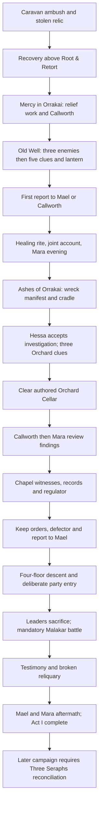

# RUNALIS World & Narrative Bible

Established for the narrative and world department: 31 October 2026. Development document; contains major spoilers.

**Current director amendment — 1 November 2026:** the playable roster is limited to the main campaign, Castle Veyreign's vampire quest, Blighted Grove, Ashen Orchard's cellar quest and the WIP Iron Mine quest. All other optional quest paths, including companion errands, the old surface investigations, Cambion/Nephilim quests and the Your Order quest chain, are retired. See [current IDs, implementation and verification](quest-roster/README.md). The older inventories and organization/side-quest descriptions below record the initial assessment; they are not authority to restore removed content. Established mythology and already-earned character/world outcomes remain intact.

This is the operational entry point for narrative work. It preserves the existing [cosmology and historical foundation](world_bible/RUNALIS_WORLD_BIBLE.md), established 21 July 2026. That foundation remains the detailed authority for cosmology, divine persons and ancient history. This document adds current director instructions, playable chronology, implementation boundaries and continuity controls. It does not turn every existing code string into approved lore.

Companion records: [assessment](RUNALIS_NARRATIVE_AUDIT.md), [prioritized backlog](RUNALIS_NARRATIVE_BACKLOG.md), [complete quest/NPC/location inventory](narrative-audit/INVENTORY.md), [document index](narrative-audit/DOCUMENTS.md), and [validation evidence](narrative-audit/VALIDATION.md).

## 1. Authority, status and change control

| Label | Meaning |
|---|---|
| CONFIRMED CANON | Established by the director or the canonical foundation; also established playable story where it does not conflict with those sources. |
| PROVISIONAL CANON | Existing development direction retained for investigation; not permission to overwrite confirmed foundations. |
| PROPOSED CONTENT | A new recommendation awaiting approval; not an in-world fact or an implemented feature. |
| UNRESOLVED QUESTION | A decision without sufficient authority or evidence. Keep the question visible. |

Implementation status is a separate axis: **playable implementation**, **data only**, **legacy**, **missing**, or **requires validation**. A working feature can conflict with canon; a confirmed fact can have no playable delivery yet. An NPC's claim is attributed belief, not automatically objective truth.

Authority order for this assessment:

1. The director's current master narrative directive, including The Three Seraphs and the three-artifact requirement before Zarynth entry.
2. The existing canonical foundation, except where the current directive explicitly changes direction.
3. Established recent implementation and its specific design reports, checked against live source. Protect the caravan/Mercy/campaign migration, Root & Retort, authored Grove/Orchard/Veyreign and Malakar climax improvements.
4. Older design data, reports and prototypes as evidence of intent or implementation history. Their age and conflicts must be recorded.

The July foundation's Act II/III frames and the newer Three Seraphs directive need reconciliation; do not silently designate existing Seraphel boss data as one of the three encounters. `storyData.js`, `dungeonData.js` and `companionData.js` are not imported by the current `main.js` dependency graph. Their detailed concepts are not proof of implemented scenes. `Runalis/src/` is the retained nested prototype; root `src/` is the current runtime.

For each substantial assignment, record source authority, revelation tier, physical anchors, dependencies, stable identifiers, saved consequences, multiplayer ownership, checks run and remaining limits. Fundamental mythology, major identities/motives/outcomes, twists, act structure and overall map changes require director direction. Routine repairs remain authorized.

## 2. Identity and themes

**CONFIRMED CANON / DESIGN:** An ancient open-world fantasy action RPG with MMO-inspired progression, meaningful exploration, dangerous distant territories and a world that remembers player actions. Discovery precedes explanation. Faith can save lives while institutions misuse it. Order, mercy, memory, refusal and consent have material costs. Neither power nor faction colors determine moral worth.

The player begins as an ordinary caravan guard. Do not silently convert that opening into a predestined messiah premise. Existing “Unbound” references require review against the Ninth's mystery; their presence does not approve an early explanation of the player's ultimate nature.

Quiet travel, optional adventures, professions, training and Your Order coexist with the campaign. Main objectives provide direction without requiring constant obedience. Narrative urgency must not falsely imply a timed failure where none exists.

## 3. World history and chronology

**CONFIRMED CANON**, summarized from the foundation, Part 5. AC means After Concordance in public teaching; restricted scholarship identifies year zero with the Veiling. BV is a development/restricted-archive convention. Early dates are approximate because histories fractured. Present campaign: **1847 AC**.

| Period | Established event or historical layer |
|---|---|
| Before stable duration | The Unbounded: possibility without persistent difference. |
| c. 12,000–10,000 BV | First Keeping; the Nine stabilize continuity and the realms. |
| c. 10,000–8,700 BV | Primordial shaping and delegated Primearch offices. |
| c. 8,700–7,200 BV | First intelligent mortal peoples; early contact and mixed settlements. |
| c. 7,200–5,900 BV | Age of Near Gods; divine civic places and the Verdant Communion's consent crisis. |
| c. 5,900–4,600 BV | Early kingdoms: Nine-Harbor Compact, Deep Measure Holds, Namar Continuance Houses, Green Embassies, Red Accord Clans. |
| c. 4,600–3,300 BV | Crowned Empires: Auric Mandate, Span Dominion, Returning League, Veyr Continuance. |
| c. 3,300–0 BV | Era of Refusals, War of Offices, Many Histories and Divine War Proper. Competing versions of reality threaten continuity. |
| 0 AC | The Eight veil Eidren; his principle survives dispersed in mortal refusal. Public history presents an agreement of Eight. |
| 1–520 AC | Ash Centuries and First Rebuildings; salvage cultures, stranded powers and frontier settlements. |
| 520–910 AC | Second Crown Age; House Veyr, Echoryn Principalities, Aureate League and route-cities. |
| 910–1138 AC | Veyr Ascendancy; inheritance custody becomes surveillance and coercive continuity. |
| 1138–1214 AC | Three Collapses: succession, infrastructure and a disastrous growth response. Orrakai expands with refugees. |
| 1217 AC | Covenant founded through hospitals, wardens, kitchens, burial houses and engineers; Seraphel grants recognition. |
| 1280–1460 AC | Luminous Expansion; beneficial standardization hardens into control; purification harms are reclassified. |
| 1492 AC | First Last Dawn forms around disclosure and independence, later radicalizing under repression and loss. |
| 1530–1690 AC | Frontier Compacts; Orrakai's uneasy Covenant relationship and renewed exploration of old sites. |
| 1588 AC | **Restricted objective truth:** Meridian Synod forms to domesticate the absent Ninth principle. |
| 1640–1765 AC | **Restricted:** Remnant Programs and failed experiments. |
| 1778 AC | **Restricted:** Zephyr Light survives engineered integration of Eidren-remnant Essence. |
| 1799–1830 AC | Zephyr's public miracles and manufactured messianic legitimacy. Genuine rescues coexist with concealed manipulation. |
| 1812–1837 AC | **Restricted:** Synod develops Rot through war residues, damaged Maerethic processes and Ninth-remnant instability. |
| 1838–1846 AC | Quiet Catastrophes; outbreaks, relief, raids and hidden research. |
| 1847 AC | Caravan attack; stolen artifact; player survives and awakens in Orrakai. |

No new dates are assigned to current quests. Important conflicts must show aftermath: damaged roads, reused fortifications, changed burial practice, displaced households or contested evidence. Not every ruin dates to the Divine War.

## 4. Gods, divine systems and public belief

**CONFIRMED CANON:** Nine necessary Accords; Eight publicly recognized Gods. Gods are limited divine persons and principles, not omnipotent moral absolutes. Faith shapes access, interpretation and stability; it does not create Gods from nothing. Full divine manifestation threatens the mixed nature of the Physical Realm.

| Public God | Principle / domain emphasis | Divine Realm | Mortal lineage in foundation |
|---|---|---|---|
| Avarr, Witnessed Flame | Testimony, oaths, civic legitimacy, accountability | City of Open Courts | Humans |
| Thessa, Returning Tide | Change, water, migration, grief | Thousand Estuaries | Karakai |
| Orun, Keeper of the Last Name | Death, remembrance, inheritance | Quiet Continuance | Namar |
| Maereth, Many-Rooted | Life, reciprocal ecology, healing and consumption | Living Exchange | Myconids and lesser plantlike peoples |
| Kharum, Weight-Bearer | Measure, craft, pressure, endurance | Bearing Deep | Dwarves |
| Varka, Keeper of the Red Accord | Conflict, boundaries, courage, surrender | Contested Plain | Orcs |
| Ilyra, Lady of the Open Table | Exchange, language, hospitality, roads | Crossroads Without Center | Serekin |
| Nymbr, Veiled Eye | Dreams, secrecy, imagination, warning | House Behind Sleep | Elves |

Realm names and exact theology defer to foundation Part 2. Divine origin does not make a people culturally uniform or owned by its patron. The merchant named Ilyra and the Goddess Ilyra are not automatically the same person. Lumora is established as a major power in the director's directive; an existing blessing invoking Lumora does not establish an additional God.

**Restricted confirmed truth:** Eidren, the Unwritten, is the Ninth: selfhood, refusal, consent, contradiction and unrealized possibility; realm, the Unwritten Country. Eidren was veiled, not casually killed. The War concerned how much freedom continuity could survive. Neither side was simply good or evil.

The ten metaphysical laws in foundation §1.9 remain binding: Cost, Correspondence, Thresholds, Dominion, Names, Witness, Echoes, Continuity, Refusal and Divine Distance. They govern relics, bloodlines and encounters. “Free” permanent miracles require a displaced cost. No invented ritual should bypass them for convenience.

Keep five knowledge layers distinct: objective truth, divine memory, institutional history, folk history and the player's discovered evidence. A lamp can show sincere belief without proving a statement true. Early public doctrine recognizes Eight; early evidence of absence must not casually name Eidren.

## 5. Primordials, Primearchs and Seraphs

**CONFIRMED CANON:** Primordials are persons with lineage, purpose, mantle, name and anchor pattern. Primearch is delegated divine office, not merely a combat power tier. Mantled, Shaped, Echo-Born and Severed describe different origins/offices/conditions. Embodied death, name-death and root-death differ. Manifestation, return and extended embodiment carry costs.

Malakar is Varka's Mantled Primordial, the Breaker of Final Sieges; extremely powerful but never a Primearch. He is a witness and former weapon/prisoner with incomplete knowledge, not a generic demon god. Seraphel is an Avarran Primearch, the Hand Beneath the Falling, publicly a protector. His danger grows from mercy that can remove freedom; do not substitute a secretly cruel fallen-angel archetype.

The foundation preserves these Primearchs; their inclusion is **lore**, not a promise of current world actors:

| Lineage | Established Primearchs |
|---|---|
| Avarr | Seraphel; Caldris; Othra Vale |
| Thessa | Neralai; Urosh |
| Orun | Edrane; Thren Veyr |
| Maereth | Sovael; Rauk |
| Kharum | Dhom Var; Avessa |
| Varka | Korveth; Iskara |
| Ilyra | Samat; Pel Aro |
| Nymbr | Veyu; Oryn |

See foundation Part 4 for motives, relationships, public mythology and individual current conditions. Do not revive missing/name-dead/dormant figures merely to fill encounters.

**UNRESOLVED:** How “Seraph” relates to lineage, office and local terminology; who the Three Seraphs are; whether Seraphel belongs to that trio. Never equate the terms Seraph, Primearch and angel without approval.

## 6. Intelligent peoples and civilizations

**CONFIRMED CANON:** Humans, Karakai, Namar, Myconids, dwarves, Orcs, Serekin and elves are established in the foundation. Mixed settlements predate many territorial claims. Their detailed modern cultures and world placement require development, not assumptions based on other fantasy settings.

**Playable implementation:** Human character creation and NPC presentation; Cambion, Nephilim and Vampire transformations/bloodlines. The latter descend from Primordial/Divine War entanglements and damaged continuity rites, not conventional moral angel/demon categories. Castle Veyreign now delivers individual consent/refusal of vampirism through Alistair's encounter. The retained `vampireRedChalice` quest no longer grants the transformation.

**UNRESOLVED:** Which nonhuman communities appear first, where they live, their contemporary political relationships, languages, economies, clothing and religious differences. No full playable settlements for those peoples were established in this audit.

## 7. Geography, settlements and political powers

Current physical authority: [continentDefinition.js](../src/continentDefinition.js), [continentScenes.js](../src/continentScenes.js), authored Echoryn geography, town/instance layouts and the generated [location inventory](narrative-audit/INVENTORY.md). Metadata coordinates can differ from final construction. Use final objects for directions and approach checks. Tile x increases east; y increases south; tile = 32 pixels.

| Playable region | Current geographic level band | Identity and connection |
|---|---|---|
| Echoryn / `hearthmereFrontier` | 1–26 | Orrakai basin, relief roads, farms, old forests, burial sites, river and fortress approaches. |
| Black Pine Pass | 12–22 | Pilgrim switchbacks and alternate ridge trail east of Echoryn. |
| Blackfen Basin | 12–24 | Southern wetland alternative, landings and sluices. |
| Aureate Marches | 18–42 | Covenant roads, fields, Saint Orvane courts, Pilgrim Rest and Shattered Choir. |
| Severed Causeway | 30–46 | Fractured crossing with a maintenance route toward the northern branch. |
| Ascension Wastes | 42–65 | Last Lantern, lightstorm sites and existing Ascension Spire. Final-story relationship to Zarynth remains unresolved. |
| Zarynth Heartlands | 30–55 | Southern highway, granges, freight yards, river crossings and watchposts. |
| Zarynth Arrival Ward | 35–60; peaceful public court | Inhabited Trade Ward, market, hearth, shrine and Nav Stone. Greater city remains unbuilt beyond the northern wall. |

The surface is one 2,880 × 960-cell continent. Region crossings do not themselves charge supplies, rebuild maps or require story progress. Orrakai's detailed three-ward town and enterable interiors remain instanced. Do not merge those spaces or treat the internal `capital` mode as evidence that Orrakai is the imperial capital.

Act I travel chain: Orrakai south gate → lower road / Old Well; eastern wreck fork → caravan evidence; farm track → Orchard; forest road → Pilgrim Bridge → northeast Chapel; back to bridge-side fork → Hunter Camp → Watcher Ridge → south fortress road → Last Dawn Keep. Greyhaven branches west from the Old Well. Quest journal and authored dialogue already describe these roads.

| Major power | Confirmed identity / current evidence | Unresolved scope |
|---|---|---|
| Zarynth Empire | Director-established empire; Mael represents its Outer Office; Greyhaven stewardship remains subject to imperial law; eastern arrival ward physically exists. | Emperor/leadership, institutions beyond the Outer Office, territorial borders, diplomacy, economy and inner capital. |
| Thalassia Republic | Director-established republic. | Leadership, constitution, history, relations, exact location and playable presence. |
| Eidralis | Director-established major civilization/power. | Government, culture, location, relations and playable presence. Similarity to Eidren's name does not establish a connection. |
| Lumora | Director-established major power; Mara places Orrakai between Lumora and Zarynth. | Political form, location/borders, history, religion and intended meaning of the existing “Lumora guide your steps” blessing. |

Do not place new national borders or equate foundation-era empires with these modern states without director authority. Zarynth entry currently has no three-artifact check; its accessible public ward and the director's entry requirement require an explicit boundary decision before implementation.

## 8. Factions, institutions and relationships

**CONFIRMED CANON:** Covenant relief is materially beneficial; its centralized power and purification policies require moral scrutiny. The Order's truth-seeking does not excuse its violence. The Meridian Synod is distinct from the Last Dawn and hidden from ordinary citizens. Wardens exercise political/public duties rather than serving as interchangeable temple guards.

| Faction | Origins, motive and internal tension | Relationship and implementation |
|---|---|---|
| Covenant of Light | Founded 1217 AC as coordinated relief; now transnational authority. Care versus compulsory order; sincere workers can be unaware of concealed crimes. | Seraphel supplies legitimacy. Callworth, Neria and Elian offer different local perspectives. `covenantOfLight` is registry identity; reputation uses `covenant`. Full leadership/succession/recruitment/territorial governance not established. |
| Order of the Last Dawn | Founded 1492 AC for disclosure/independence; decentralized cells radicalized. Witness-seeking versus atrocity and sacrificial coercion. | Attacks relief caravans, burns/selects records and steals artifacts; four leaders sacrifice themselves to summon Malakar. Defectors/remnants differ from leaders. Legacy registry `demonCult` stays stable. Complete cell leadership map remains unresolved. |
| Meridian Synod | Hidden 1588 AC coalition of officials, scholars, engineers and mystics; seeks domesticated refusal and managed dependence. | Engineered Zephyr and Rot per restricted canon. No dedicated active faction registry, political quest chain or fully authored physical institution identified. Seraphel's exact knowledge is deliberately unresolved. |
| Wardens | Frontier protection and civil authority; Mael investigates Rot and missing caravans for Zarynth's Outer Office. | Cooperates critically with Covenant relief; grants lawful Greyhaven stewardship. Registry `outpost`; reputation `wardens`. Broader charter, leadership and territorial remit unresolved. |
| Your Order | Optional player-founded Greyhaven organization; shelter, work, leadership and knowledge policies. | Nine implemented quests; consensual recruits, duty-preserving affiliates, refusal/trust checks, assignments, undertakings and shelter outcomes. Current recruitment uses a limited candidate list, not all NPCs. |
| House Veyr / Veyreign | Orunic inheritance custody hardened into dynastic control; Alistair's stolen-heartbeat court is playable. | Optional castle story; `castleCourt`, `castleVeyr`, `gothicCastle` remain technical identities. Genealogical relationship of newer Veyreign presentation to the foundation's Veyr account needs editorial reconciliation. |
| Thornbound / Gravecallers | Reciprocal nature oaths / memory and ethical relations with the dead. | Trainers, local quests and POI approaches exist; complete institutional leadership and internal politics remain undeveloped. |
| Roadless Men / Saltwell Hunters / Ridge Watchers / Covenant Ruin-Keepers | Road predation and desertion / river subsistence and scouting / high-place observation / damaged-site relief and history. | Local actors, encounters and quests exist. Registry alignment describes a default, not universal moral judgment or a complete diplomacy simulation. |

Reputation is currently recorded through dialogue effects and shown in the journal. Main reputation keys (`covenant`, `wardens`, `orrakai`) differ from faction registry keys. This assessment found no general reputation-threshold system controlling prices, jurisdiction, hostility, recruitment or faction quest access. Your Order's **separate** relationship/policy checks already have consequences. Do not advertise a complete living-faction simulation.

## 9. Important characters, motivations and knowledge

Exact coordinates and all 106 observed NPC identities/appearances are in the [inventory](narrative-audit/INVENTORY.md). Counts include conditional fixtures and repeated dungeon appearances, not 106 fully developed characters.

| Character | Place / role | Motivation, voice and knowledge boundary |
|---|---|---|
| Mara Vell | Upstairs above the Root & Retort, Orrakai; healer/Thornbinder trainer | Practical care and living medicine; personal, skeptical, grounded. Knows wounds/roots and local recovery, not the complete Synod truth. |
| Oren Fenwick | Root & Retort downstairs counter | Resident alchemist serving the Vell family; medicines and upstairs directions. Never inherit Mara's trainer/companion identity. |
| Warden Mael | Infirmary paperwork station; conditional evening/Greyhaven appearances | Names, evidence, civic duty and accountable authority. Skepticism without unsupported accusations. Knows imperial remit and investigation, not objective cosmology. |
| Cardinal Callworth | Orrakai infirmary and healing scene; legacy `lightwardenCaelen` | Genuine exhausted relief leader who withholds missing-patrol information; accepts accountability. Neither saintly certainty nor an automatically knowing Synod agent. |
| Sister Neria | Healing rite / upper ward | Patient triage and care. Demonstrates the institution's benefit before unease emerges. |
| Bram | Orrakai training yard; later region appearance | Preparation and ordinary courage; training/work options stay available during story dialogue. |
| Scout Hessa | Caravan wreck; `act1ReliefScout` | Missing wagons, cargo and reopened relief route. Distinct from distant `hunterScout`. |
| Sister Elyra / Chapel Hermit | Broken Chapel | Separate surviving accounts, damaged records and mechanisms. Neither disappears after optional resolution when needed by the main quest. |
| Kaelen Dusk | Orrakai / later Wastes appearance | Names of the dead and skepticism of coercive light. Existing Unbound explanations need revelation review. |
| Sister Elian | Orrakai / Marches appearance | Faith's protective purpose versus institutional obedience; existing companion quest is not a complete relationship arc. |
| Last Dawn Defector | Outside Last Dawn Keep | Firsthand methods and accountability for violence; testimony does not absolve the Order. |
| Malakar | Keep's fourth-floor Ritual Sanctum | Summoned Divine Age witness, dangerous even when speaking truth. Defeat is mandatory; warning about Seraphel is testimony, not omniscient exposition. |
| Seraphel | Existing Shattered Choir boss; canon Avarran Primearch | Mercy/protection becoming removal of choice. Existing Uncrowned/fallen-angel presentation conflicts with foundation; no automatic approval to replace his identity. |
| Zephyr Light | Existing Spire boss; restricted foundation identity | Manufactured messiah who ultimately chooses domination; public rescues are real. Old assimilation/endings material is not approved final campaign truth. |
| Edda / Mother of Briars | Authored Blighted Grove | A protective vow binds three children; release their names, end the corrupted promise, return for the quiet conclusion. |
| Tamsin / Orchard engineer / Pump-Crowned Custodian | Orchard cellar and relief camp | Infrastructure, contamination, abandoned duty and a debrief; preserve valves, guarded routes and aftermath. |
| Alistair Veyreign / Castellan Edrik's Echo | Castle interior / exterior respectively | Lord's coercive court and personal vampire choice; exterior echo is not a duplicate Alistair. Preserve mandatory beast transformation. |
| Tavin, Iona, Pell, Corven, Derren, Lysa | Greyhaven and conditional shelter/transfer scenes | Roof/work, garden/care, road knowledge, risky research, family survival and treatment consent. Policy choices already affect trust and shelter. |

## 10. Main story chronology and dependencies

**Playable implementation:** two Act I quest records, not the obsolete raw stage list earlier in `questData.js`. That file replaces its Act I stages at module load with `CAMPAIGN_STAGES`; always inspect final exported data.

### Mercy in Orrakai — `mercy_in_orrakai`

Sequential stable stages: `speakWithMara` → `findWardenMael` → `aidPlagueTents` → `reportToWardenMael` → `speakWithCaelen` → `investigateOldWell` → `returnOldWellEvidence` → `witnessHealingRite` → `confrontEvidence` → `returnToMara`.

First report branches preserve who saw the lantern and who holds it; first report is not a verdict on the conspiracy. Healing is a timed witnessed event with a marked patient's interruption, not simply clicking a shrine. Joint confrontation concerns names/dates; home conclusion occurs upstairs. Completion rewards and `mercy.complete` are implemented. Campaign runtime starts the next investigation.

### Ashes of Orrakai — `act1HearthmereAshes`

Sequential stable stages: `aLanternInTheMud` → `handsThatStillWork` → `theWoundSpreads` → `failedPurificationSite` → `theCovenantBlessing` → `evidenceForMara` → `theBrokenChapel` → `theRedSeal` → `descentBeneathHearthmere` → `malakarAndTheRoot` → `ashesOfOrrakai`.

Critical prerequisites: two wreck clues; Hessa's explicit acceptance; three distinct Orchard clues; actual cellar clear; both Chapel witnesses, three clues and `act1.machineAligned`; ritual orders, defector and Mael; dungeon entry; `story.malakarDefeated`, `story.malakarTruthHeard`, `act1.relicSecured`; final Mael/Mara conversations. Victory alone does not replace testimony, relic recovery or epilogue.

Malakar: four leaders knowingly sacrifice themselves; 18-second staged ritual; three introduction responses converge intentionally on the **mandatory** battle. They are characterization choices, not advertised alternate peaceful outcomes. Party readiness, skip/retry/save handling and synchronized arrival are implemented. Keep completion does not use the generic timed reset. Preserve exact-entrance return behavior and separate final testimony.

Completion rewards include Pilgrim Road permit, boss core, supplies/coin and `story.act1Complete` / `travel.pilgrimRoad.unlocked`. Region arrival starts the old next act only when both preceding quest completion and flag are present. Boss callback progression does not currently enforce the same protection; see backlog N-001.

### Act II — The Three Seraphs

**CONFIRMED DIRECTOR DIRECTION:** After Malakar the player continues working with the Covenant despite his warning. Three distinct domains on the journey toward Zarynth; obtain an artifact from each; all three required before entry. Meaningful alternative resolutions where justified; open-ended order.

**PROVISIONAL OPTIONS:** Fortress/castle, ancient dungeon and supernatural/dimensional realm are candidate domain forms, not assigned locations or final canon.

**CURRENT CONFLICTING IMPLEMENTATION:** `act2AureateReckoning`, The Beautiful Cage, has three sequential stages: discover Pilgrim Bridge, speak to Elian/kill six eligible enemies, enter/clear Shattered Choir and defeat Seraphel. No Three Seraphs quest, trio artifact contract, negotiation outcomes or Zarynth admission check was identified. Do not rename three existing objects and claim this requirement fulfilled.

**UNRESOLVED:** identities; domain anchors; why three artifacts are necessary; custody/loss/recovery rules; negotiation/combat consequences; Covenant's specific commission; Seraphel's role; whether the public Trade Ward lies outside the restricted entry boundary; migration of current Act II saves.

### Later story and endings

`act3Severance` currently implements two generic kill stages followed by Ascension Spire entry/clear and flags for an ending opportunity. Foundation Act III places the political/Synod/Ninth investigation in Zarynth. No complete playable capital investigation or three-way ending resolution was established. Old `ENDINGS` data, including a `preferredCanon` field, is **legacy design data**, not fresh director approval of an ending.

The World Bible keeps the known hidden history and reveal restrictions without deciding final act outcomes, Zephyr's ultimate fate, the player's identity or Eidren's ultimate role.

## 11. Quest catalog and consequences

Full inventory: **43 definitions, 127 stages, 179 objective records**. Required counts within an objective are not additional records. Registry includes legacy content; this is not a certification of 43 fully playable quests.

| Chain / family | Content and continuity contract |
|---|---|
| Current main spine | Mercy → Ashes of Orrakai; old Act II → old Act III pending director-aligned redesign. |
| Deprecated campaigns | `hollowCrown` and `solgateOath` retained for old progress; fresh offer filters suppress them. Their Veyr Warden/Ember Veil/Solgate prose needs quarantine/migration, not resurrection as a competing main story. |
| Local quests | `firstOath`, `roadsGoneQuiet`, `ironForMara`, `candlesInTheChapel`, `theVeyrBloodline`, `theBlackSpire`, `rootsRemember`, `ironMireSalvage`, `beneathTheRedSeal`, `roadlessJustice`, `embersOnTheRoad`, `buriedName`, `wrongByMorning`, `silverInTheRiver`, `facesInTheWater`, `lanternsInTheMire`, `theRidgeLooksBack`. Full stages/rewards in inventory; discovery is not proof of complete resolution testing. |
| Authored investigations | `ashenOrchardLastHarvest` and `ruinedChapelFireCouldNotErase`: distinct clues, paid/class/bloodline approaches, permanent outcomes, changed props/services/witnesses and journal summaries. Many `future.*` flags remain hooks without demonstrated later consumers. |
| Authored adventures | `groveLastLullaby`: three children's bindings, Mother, Edda conclusion. `orchardBelowTheBurn`: camp assignment, valves/guards, Custodian, report. `vampireRedChalice`: five-floor castle account with personal encounter-driven choice. |
| Companion quests | Mara's medicine/road work; Bram's supplies/drill; Dusk's names/remains; Elian's oath/Choir. These exist; relationship-driven traveling-party and full personal arcs are not implied. |
| Bloodline quests | Cambion and Nephilim require permanent informed turn-in and exclusivity. Current vampire transformation is encounter-based; retain the old stable quest ID without restoring obsolete rewards. |
| Your Order | `yourOrder1` through `yourOrder9`: survey → lawful charter → repairs/food/cistern/beasts/residents → founding → willing recruits/assignments → undertaking → knowledge/leadership policies → shelter decision → Mael recognition/gathering. Optional throughout. |

Consequences must distinguish immediate implementation from promised futures. Orchard choices alter its state; Chapel outcomes include Covenant sanctuary, sealed archive, Last Dawn cache, restored cemetery, collapsed foundation or neutral memorial. An escape flag is not a later quest until an actual consumer exists. Follow-up design must respect chosen control of evidence, survivors and services.

## 12. Dungeons and exploration

Twelve surface dungeon entrances resolve to eleven distinct identities: Old Blighted (`oldHollowDungeon`), Thornroot (`thornrootHollow`), Iron Mire (`ironMireDungeon`), Ashen Orchard (two entrances, shared `ashenOrchard`), Mirror Grove (`mirrorGrove`), Pilgrim Crypt (`pilgrimBridge`), Watcher Ridge vault (`watcherRidge`), Castle Veyreign (`castleVeyr`), Last Dawn Keep (`demonCultLair`), Shattered Choir and Ascension Spire. Authored Grove is a side zone, counted separately. Other side-zone and repeatable tower entrances are listed in inventory data.

Protect authored identities: Orchard household/irrigation/Divine Age infrastructure; Chapel archive/cemetery/regulator; Grove protective vow and children's gardens; Veyreign banquet, ossuary, aviary, reliquary and court; Keep occupied rooms, prisonworks, witness vault and sanctum. Procedural generators may fill supporting spaces but cannot substitute for these required scenes.

Current exploration includes 78 authored surface location records, 12 surface Nav Stones, eight authored landscapes, route signs, world relic/inscription/secret interactions, caches, gathering/fishing/logging/mining, weather/ambient life, optional zones/towers and five more recent authored gameplay discoveries. These counts reflect records/anchors, not an equal number of unique adventures. Full settlement hubs are chiefly Orrakai and the limited Zarynth Trade Ward; camps, granges and shelters must not be described as finished cities.

Dynamic activity currently centers on authored-area patrols, wolves, grave-road groups, Last Dawn scouts and travelers, with geographic selection, bounded residency and saved event identities/timers. Full merchant rescues, territory conflicts, evolving outbreaks and faction-controlled settlements were not established as reusable narrative events. Expand authored outcomes before expanding frequency. Some source comments and older reports describe lower caps than current code; performance claims require fresh measurement.

## 13. Rot Blight continuity

**CONFIRMED CANON:** Major engineered ecological/narrative system; Blight Flowers, connected roots, Rotflower Beasts and corrupted environments belong to it. Synod origin is restricted late-game truth. Its failed control trials do not make every Covenant responder complicit.

**Playable evidence:** roots follow older channels/foundations; burned surface and contaminated irrigation carry different evidence; relief can hold an outer perimeter while growth persists below; Orchard work exposes infrastructure; Grove shows an entangled protective vow. Black roots linking graves by remembered relationships are a local supernatural observation, not proof that every Rot outbreak spreads identically.

**UNRESOLVED:** Complete lifecycle of flowers, root reservoirs and beasts; regional transmission/dormancy; how water, Essence and memory differ as vectors; treatment versus eradication; relationship between natural/older corruption and the engineered modern strain; exact enemy taxonomy. No centralized complete lifecycle model or explicit named flower/beast registry was identified. Do not apply one universal explanation to all generic corrupted enemies or turn early medicine into a total cure.

## 14. Revelation and knowledge controls

| Tier | Player evidence permitted | Prohibited shortcut |
|---|---|---|
| Opening / early Act I | Genuine relief, violent raids, lost cargo, failed harvests, uneasy artifacts | Random citizens explaining Eidren, Synod engineering or Zephyr's manufacture. |
| Orchard / Chapel | Contradictory testimony, historical layers, suspicious channels/records, structural absence | A common readable that solves the whole conspiracy or definitively names the Ninth. |
| Malakar aftermath | The Order sought a witness, not worship; warning about Seraphel/Covenant; unresolved ancient removal | Treating Malakar as all-knowing or making his warning instantly prove every relief worker guilty. |
| Act II | Earn distrust through material evidence while working with Covenant; Three Seraphs details pending | Existing generic boss callback granting a completed act or premature Zephyr revelation. |
| Late political investigation | Earn Synod/Rot/Zephyr connections through multiple channels | Ordinary merchants/witnesses knowing restricted experiments without provenance. |
| Late Ninth revelation | Eidren and objective hidden history after accumulated absence/consent evidence | Using erased-name truth as decorative early lore. |

Old `dialogueData.js` Echo text says Runalis was first a mortal/name rather than a world; that conflicts with the foundation's First Keeping account. A player's marked experience or an unreliable witness can be intentional only if its provenance and later interpretation are authored. Do not assume contradiction means deliberate unreliability.

**UNRESOLVED:** exact late revelation order, player's nature, Seraphel's knowledge of the full Synod program, final treatment of the old Dawnspire Network/Unbound ending framework, artifact provenance after the broken reliquary is secured. Track these as decisions, not facts.

## 15. Runtime, state and multiplayer contracts

Active quest authority: [dialogueSystem.js](../src/dialogueSystem.js), using combined final registries from `worldContent.js` / `questData.js`. `questSystem.js` is an unused alternative and must not be revived for new content. The live system stores `player.quests.active/completed`, stage index plus stable ID, current objectives and `rewardedStages`; it also synchronizes compatibility state. Preserve IDs and existing migration paths.

Story flags live in `player.story.flags` through `storyProgress.js`; `story.` prefixes normalize away. `applyStoryFlags` also performs selected route/companion/act effects. Do not assume every plain flag assignment has the same effects. POI clues/resolutions live in `poiStates`; exploration in `worldMemory`; sparse continental entity/event state in continental persistence; instance/encounter and personal Veyreign choices have separate records.

Save schema is **18**. `gameSave.js` and `saveProfiles.js` normalize/migrate profiles, serialize player state and interrupted dialogue, reconstruct worlds and preserve sparse/instance metadata. Authored repeatable expeditions can intentionally end on logout while personal choices persist; this is not equivalent to a lost quest. Never remove personal consequences when clearing session state. Browser localStorage is origin/device-specific; no cloud save is implied.

Shared campaign progress follows the quest owner/host. Bloodline quests and permanent transformations are personal; optional topic-read history can be actor-owned. Party entry uses deliberate consent; an actor's vote cannot be cast by another. Location transitions gather the relevant party. Shared progression does not imply every individual reward or topic should be copied indiscriminately. Future content must specify its owner and reward rules before implementation.

## 16. Naming, writing and environmental conventions

Player-facing names: **Orrakai**, **Echoryn Forest**, **Cardinal Callworth**, **Order of the Last Dawn**, **Last Dawn Keep**, **Castle Veyreign**, **Root & Retort**. Preserve `capital`, `hearthmereFrontier`, `lightwardenCaelen`, `demonCultLair`, `emberVeilLairEntrance`, `castleVeyr`, `gothicCastle`, `lordVeyrShade`, `maraSmith` and old quest/stage IDs where saves depend on them. Stable technical names are not permission to display obsolete theology or geography.

Write character-specific concise speech: Mael weighs evidence; Callworth bears practical triage pressure; Mara observes living things and cares personally; Bram prepares ordinary people; Dusk distinguishes remembrance from ownership. Give ordinary witnesses local facts and uncertainty. Ancient knowledge still needs provenance and motive. Avoid rotating the same monologue across occupations.

Keep promises concrete. Directions must match the road, river crossing, orientation and entrance. State what an interaction actually accomplishes. Do not advertise persuasion if combat is mandatory, or escort mechanics where only generic kill objectives exist. Characterization responses may converge when that is honest; consequential choices must change saved state and be acknowledged.

Environmental evidence has a builder, era, original use, later reuse, present disturbance and an identifiable observation. Each important intended lore fact needs at least two non-expository discovery channels, per the foundation. A first encounter raises a question; a second provides a pattern; dialogue can then test interpretation. Do not put a full cosmology lecture in a random book.

Dungeon specifications must name purpose, location/entrance, layout/landmarks, occupants, manifestation/anchor where relevant, discoveries, unique interactions, boss context, rewards, shortcuts and actual exit rules. Quest specifications must also name alternate/interrupted states, early visits, save/migration handling and solo/co-op ownership. Art requirements describe historical/narrative evidence; combat requirements describe motive, stakes and consequences. Specialized directors retain visual/combat architecture ownership.

## 17. Open decisions and department maintenance

| Decision | Current status / dependency |
|---|---|
| Three Seraph identities and domains | UNRESOLVED; director approval before major Act II implementation. |
| Three-artifact necessity and Zarynth boundary | UNRESOLVED; accessible Trade Ward already exists, so “entry” needs an explicit definition. |
| Seraphel's role and knowledge | Confirmed Avarran Primearch; role in trio and extent of Synod knowledge unresolved. |
| Later act geography and outcomes | Foundation Zarynth political investigation conflicts with old Wastes/Spire progression; director decision required. |
| Ninth's ultimate role / player identity | Preserve mystery; no newly approved ending or divine identity. |
| Modern nations and nonhuman settlements | Names/origins established; detailed borders, governments and playable cultures unresolved. |
| Rot lifecycle and classification | Define from existing scenes before adding generic spread systems. |
| Veyr/Veyreign genealogy and old quest descriptions | Preserve current authored castle while reconciling names/history and saved old tasks. |
| Reputation authority/thresholds | Current counters and Order relationships exist; general world response contract missing. |

The [backlog](RUNALIS_NARRATIVE_BACKLOG.md) orders repairs before expansion. Update this bible and the relevant specification after every assignment; retain evidence of changed canon/status and never relabel a proposed solution as confirmed merely because it was easy to implement.
